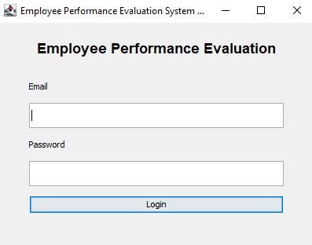
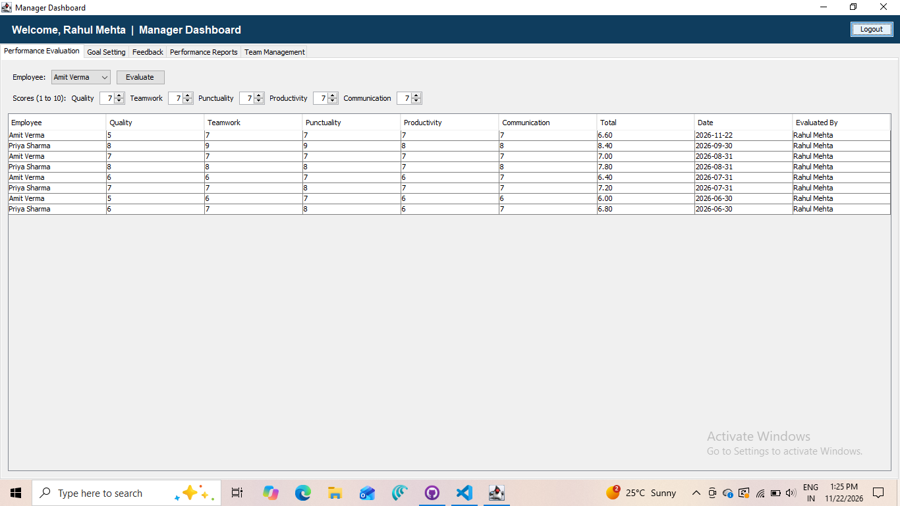
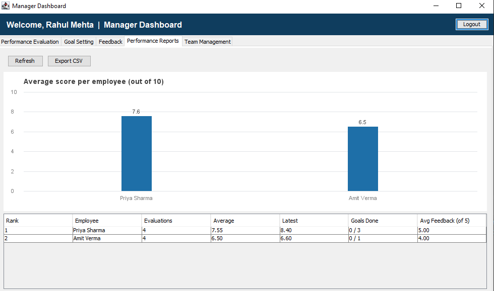
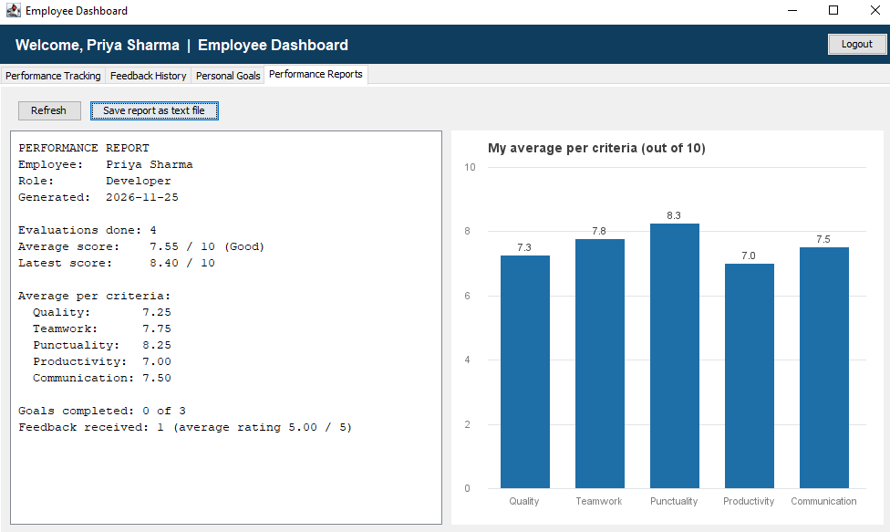

# Employee Performance Evaluation System (EPES)

A Java desktop application where **managers** evaluate employees, set goals, give feedback and view reports, and **employees** track their own performance. Built with **Java Swing**, **JDBC** and **MySQL**.

> GUVI Java project - Review 2

## Team

| Name | Role / Modules |
|------|----------------|
| Aryan Solanki | Developer |
| Aakash | Testing |
| Sanchita | Documentation |

## Features

**Manager**
- Performance Evaluation: score an employee (1-10) on Quality, Teamwork, Punctuality, Productivity and Communication; the average is saved and a report is shown
- Goal Setting: set goals with a target date for employees
- Feedback: give comments and a 1-5 rating
- Performance Reports: team ranking table, bar chart, export to CSV
- Team Management: add an employee, change a team role, remove an employee

**Employee**
- Performance Tracking: line chart of own scores over time
- Feedback History: read feedback from the manager
- Personal Goals: add own goals and update their status
- Performance Reports: own report, criteria chart, save as text file

## Screenshots

| Login | Manager - Evaluation |
|-------|----------------------|
|  |  |

| Manager - Reports | Employee - Performance Tracking |
|-------------------|---------------------------------|
|  |  |

## Technologies

- Java 17, Swing (GUI)
- JDBC with PreparedStatement
- MySQL 8
- Maven (dependency: mysql-connector-j 8.4.0)

## Project structure

```
src/main/java/com/epes/
  Main.java         entry point
  model/            User (abstract), Manager, Employee, Evaluation, Goal, Feedback, Criteria, EmployeeSummary
  dao/              GenericDAO<T>, UserDAO, EvaluationDAO, GoalDAO, FeedbackDAO (all database code)
  service/          AuthService, EvaluationService, GoalService, FeedbackService, ReportService, TeamService, UserService
  exception/        custom exceptions (InvalidCredentials, Validation, RecordNotFound, Database)
  util/             DBConnection, PasswordUtil
  ui/               Swing screens (LoginFrame, dashboards and one panel per feature)
sql/schema.sql      database tables and demo data
```

## Concepts used

- **OOP:** abstraction (`User`), inheritance (`Manager`, `Employee`), polymorphism, interface (`GenericDAO<T>`), encapsulation, custom exceptions
- **Collections and generics:** `List`, `Map`, `EnumMap`, `Comparable`, `Comparator`, generic DAO interface
- **Multithreading:** `SwingWorker` for every database call (the screen never freezes), a thread pool (`ExecutorService`) for the team report, `synchronized` methods
- **Database / JDBC:** DAO classes, PreparedStatement, try-with-resources, JOIN queries, foreign keys
- **Security:** passwords stored as SHA-256 hashes, database password kept out of GitHub

## How to run

1. Install **Java 17**, **MySQL 8** and **Maven**.
2. Create the database: open `sql/schema.sql` in MySQL Workbench and run it.
3. Copy `db.properties.example` to `db.properties` and write your MySQL user and password in it. (`db.properties` is ignored by Git, so your password is never uploaded.)
4. Open the folder in VS Code (Extension Pack for Java) and run `Main.java`.

## Demo logins

| Role | Email | Password |
|------|-------|----------|
| Manager | manager@epes.com | manager123 |
| Employee | priya@epes.com | emp123 |
| Employee | amit@epes.com | emp123 |

## Database

Tables: `teams`, `users`, `evaluations`, `goals`, `feedback`. See `sql/schema.sql`.
